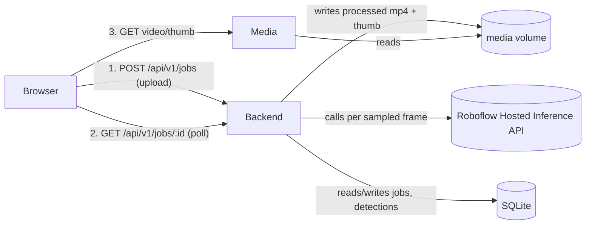

# How It Works — End-to-End Guide

This document explains exactly how the Road Surface Conditions Analyzer works,
from a video upload to a finished, playable analysis — and what to check
before running it in front of a client on a server that isn't `localhost`.

It complements [`Road_Surface_Conditions_Analyzer_Final_Architecture.md`](Road_Surface_Conditions_Analyzer_Final_Architecture.md)
(design doc) and [`IMPLEMENTATION_PLAN.md`](IMPLEMENTATION_PLAN.md) (build plan) with a
"how does it actually behave right now" walkthrough.

---

## 1. The three containers

`docker-compose.yml` runs three services on one Docker network (`rda`):

| Service    | Container      | Port | Role |
|------------|----------------|------|------|
| `backend`  | `rda-backend`  | 8007 | FastAPI API + background video processing worker |
| `frontend` | `rda-frontend` | 3007 | nginx serving the built React/Vite SPA |
| `media`    | `rda-media`    | 3006 | nginx serving processed videos/thumbnails (read-only) |

Two named volumes tie them together:
- `media` — shared between `backend` (read/write) and `media` service (read-only). Holds `uploads/`, `processed/`, `thumbs/`.
- `dbdata` — the SQLite database file, mounted only into `backend`.

The frontend and the media server are **separate nginx containers** so that
large video files are served by a lightweight, purpose-built static file
server instead of going through the API process.



---

## 2. Upload → job creation

1. The user drops/selects a video on the **Upload** page (`frontend/src/pages/Upload.tsx`), which calls `uploadVideo()` in [`frontend/src/api/client.ts`](frontend/src/api/client.ts) → `POST /api/v1/jobs` (multipart form, `timeout: 0` because uploads can be large).
2. `create_job()` in [`backend/app/api/routes.py`](backend/app/api/routes.py):
   - Validates the file extension (`ALLOWED_EXTENSIONS`) and sniffs the first 12 bytes to confirm it's really a video container (`_sniff_container`), rejecting anything else with `415`.
   - **Disk-space guard**: checks `shutil.disk_usage(settings.media_root)` and refuses the upload with `507 Insufficient Storage` if free space is under 3× `MAX_UPLOAD_MB` (protects against the volume filling up mid-demo and crashing the backend).
   - Streams the upload to `media/uploads/{job_id}.{ext}` in chunks (never loads the whole file into memory), enforcing `MAX_UPLOAD_MB` as a hard cap.
   - Inserts a `Job` row with `status="queued"` into SQLite.
   - Submits the job to the background worker and immediately returns `202 Accepted` with `{job_id, status, filename}`.

## 3. Background processing worker

[`backend/app/processing.py`](backend/app/processing.py) owns a single-worker
`ThreadPoolExecutor` — jobs run **one at a time**, in submission order. This
keeps memory/CPU/API-quota usage predictable during a demo (no risk of two
uploads fighting over Roboflow rate limits or CPU at once). On startup,
`reap_interrupted_jobs()` marks any job left in `processing` from a previous
crash/restart as `failed`, so the UI never shows a job stuck "processing"
forever.

For each job, `process_video()` in [`backend/app/ml/video_pipeline.py`](backend/app/ml/video_pipeline.py) runs:

1. **Warm-up (parallel, non-blocking)**: a `RoboflowClient` is constructed and a background thread immediately calls `warm_up()`, which forces the underlying `httpx.Client` (and its TCP/TLS connection pool) to be built *before* the video is even opened. This removes ~29s of dead time that used to happen on the first API call.
2. **Open video**: OpenCV (`cv2.VideoCapture`) opens the upload; `ffmpeg` is spawned as a subprocess to receive raw BGR24 frames on stdin and re-encode them to H.264/yuv420p MP4 with `+faststart` (so the browser can start playing before the whole file downloads).
3. **Immediate progress tick**: right after ffmpeg starts, a `progress_cb(0.5, ...)` fires so the UI shows movement almost instantly instead of appearing frozen.
4. **Frame loop with concurrent detection dispatch**:
   - Frames are read sequentially, but only every `FRAME_STRIDE`-th frame (default 5) is actually sent to Roboflow — the frames in between reuse the most recent detections ("stale" boxes, drawn slightly thinner/dimmer).
   - Each sampled frame's `.detect()` call is submitted to an inner `ThreadPoolExecutor` (`max_workers=MAX_CONCURRENT_REQUESTS`, default 8) so up to 8 Roboflow HTTP calls are in flight at once — this is the fix for the "10x slower" issue (Roboflow's per-call latency, ~4s, is network-bound, not CPU-bound, so parallelizing calls gives a near-linear speedup).
   - A bounded `pending` deque (size ≈ `max_workers × frame_stride`) holds frames waiting for their detection result, draining oldest-first once full so frames are still written to ffmpeg **in original order** despite out-of-order API completions.
   - Each drained frame gets bounding boxes + class label drawn directly onto the pixels (`_draw()` — 3px boxes, label text sits on top of the box's top border, clamped to frame bounds) plus a small HUD overlay (`_overlay_hud()`), then is piped to ffmpeg's stdin.
   - Detections are batched and flushed to SQLite periodically (not per-frame) to avoid excessive DB writes.
   - `progress_cb` is invoked after each drained frame, updating `Job.progress`/`frames_processed` in the DB so the frontend's poll reflects real progress.
5. **Finish**: once all frames are drained and ffmpeg finishes muxing, the job's `processed_path`/`thumb_path` are set, `status` becomes `done` (or `failed` with an error message on exception), and `finished_at` is recorded.

**Important — nothing is drawn client-side.** The bounding boxes, labels, and
HUD are baked directly into the output MP4 pixels on the server. The browser
just plays back a normal video file; there is no canvas overlay to keep in
sync with playback.

## 4. Polling & progress in the UI

[`frontend/src/hooks/useJobPolling.ts`](frontend/src/hooks/useJobPolling.ts) polls `GET /api/v1/jobs/{id}` roughly once per second while a job is `queued`/`processing`, stopping once it reaches `done`/`failed`. On network errors it backs off exponentially (1s → 2s → 4s → 8s cap) and surfaces an "offline" banner rather than spamming failed requests — this keeps the UI resilient if the backend container briefly restarts mid-demo.

The [`Processing`](frontend/src/pages/Processing.tsx) page uses this hook to
drive the animated progress ring (`three/ProgressRing.tsx`) and ETA display,
then auto-navigates to the Dashboard once `status === "done"`.

## 5. The History page — how video presentation works

[`frontend/src/pages/History.tsx`](frontend/src/pages/History.tsx):

1. On mount, calls `listJobs(24)` (`GET /api/v1/jobs?...`) and `getStats()` (`GET /api/v1/stats`) in parallel to populate the summary cards (jobs total/done/failed, detections, Roboflow calls) and a grid of past job cards.
2. Each job card shows its `status` badge, filename, and timestamp. Clicking a **completed** job navigates to `/jobs/{id}/dashboard`; clicking a still-running job goes to the processing screen instead (`openJob()`).
3. A delete button (`deleteJob()`) calls `DELETE /api/v1/jobs/{id}`, which removes the DB row **and** the associated files on disk (upload/processed/thumb) — this is the only cleanup mechanism today (see §7, no automatic retention policy yet).

The card's thumbnail image and, once you open a job, the actual `<video>`
player, both point at URLs the **backend already fully qualified** in its
API response:

```
video_url = f"{settings.media_public_url}{job.processed_path}"   # e.g. http://localhost:3006/processed/<job_id>.mp4
thumb_url = f"{settings.media_public_url}{job.thumb_path}"        # e.g. http://localhost:3006/thumbs/<job_id>.jpg
```

So the frontend never has to construct media URLs itself — it just renders
whatever the backend gives it. The **Dashboard** page ([`frontend/src/pages/Dashboard.tsx`](frontend/src/pages/Dashboard.tsx)) renders `<video ref={videoRef} src={job.video_url} .../>` — a plain HTML5 video element (no `crossOrigin` attribute, so browser CORS restrictions on the response body don't apply to normal playback/seeking). Clicking a point on the detection timeline sets `videoRef.current.currentTime` and calls `.play()`, letting you jump straight to a moment where a defect was detected.

The `media` nginx container (`docker/media.nginx.conf`) serves `/processed/*` and `/thumbs/*` with `Accept-Ranges: bytes`, which is what lets the browser seek/scrub through the video instead of only playing from the start. `/uploads/*` (the original, unprocessed files) are explicitly denied — only annotated output is ever exposed publicly.

## 6. Running the demo on a different host (not `localhost`)

This is the part most likely to silently break during a live demo if skipped.

**Frontend URLs are baked in at Docker *build* time, not read at runtime.**
`docker/frontend.Dockerfile` passes `VITE_API_URL`/`VITE_MEDIA_URL` as build
`ARG`s into `vite build`, and Vite inlines them into the compiled JS bundle.
That means:

- Changing `.env` and running `docker compose up -d` **without `--build`**
  has **no effect** on the frontend — you must rebuild it:
  ```
  docker compose up -d --build frontend
  ```
- Before that rebuild, set in your root `.env` (or shell environment):
  ```
  VITE_API_URL=http://<demo-host-or-ip>:8007
  VITE_MEDIA_URL=http://<demo-host-or-ip>:3006
  ```

**Backend CORS must match whatever origin the browser actually uses.** Set:
```
CORS_ORIGINS=http://<demo-host-or-ip>:3007,http://<demo-host-or-ip>:3006
```
(comma-separated, no spaces) — `backend/app/config.py`'s `cors_origin_list`
splits on commas. This is read from `docker-compose.yml`'s `environment:`
block, currently **hardcoded** to `http://localhost:3007,http://localhost:3006`
in the compose file rather than templated from `.env` — update that line (or
switch it to `${CORS_ORIGINS:-...}` like the other variables) before a
non-localhost demo.

**`MEDIA_PUBLIC_URL` controls the video/thumbnail URLs returned by the API.**
Default is `http://localhost:3006`. Set it to `http://<demo-host-or-ip>:3006`
in `.env` so `video_url`/`thumb_url` in API responses resolve correctly from
the client browser (this one *is* read at backend runtime, no rebuild needed
— just a container restart).

**The media nginx CORS header is hardcoded** to `http://localhost:3007` in
`docker/media.nginx.conf` (`Access-Control-Allow-Origin`). Plain `<video>`
playback works regardless (browsers don't enforce CORS for normal media
playback without a `crossOrigin` attribute), but if you ever add
canvas-based frame capture or `fetch()`-based video loading, update this too.

**Checklist for a non-localhost demo:**
1. Set `VITE_API_URL`, `VITE_MEDIA_URL`, `MEDIA_PUBLIC_URL`, `CORS_ORIGINS` in `.env` to the demo host's reachable address.
2. `docker compose up -d --build` (full rebuild — frontend needs it, backend picks up env changes on restart either way).
3. Open `http://<demo-host>:3007` and confirm the health badge is green and a fresh upload completes end-to-end.

## 7. Production-hardening applied this session

- **API-key log leak fixed**: httpx/httpcore's own request loggers (which log full URLs, including Roboflow's `?api_key=...` query parameter) are now silenced to `WARNING` in `backend/app/main.py`. Verified: `docker compose logs backend` no longer prints the key during a job run.
- **Global exception handler added**: any unhandled exception in a request now returns a generic `500 {"detail": "Internal server error..."}` instead of leaking a Python stack trace to the client (OWASP A05 — Security Misconfiguration). Full details still go to the server log via `logger.exception(...)`.
- **Disk-space guard added**: uploads are refused with `507 Insufficient Storage` if the media volume doesn't have at least 3× `MAX_UPLOAD_MB` free, preventing an unbounded upload sequence from filling the disk and crashing the backend mid-demo.
- **Frontend ErrorBoundary added**: a React error boundary now wraps `<App />` (`frontend/src/main.tsx` / `frontend/src/components/ErrorBoundary.tsx`), so a UI-layer crash shows a "Something went wrong" recovery screen with a button back to Home instead of a blank white page.
- **Concurrency + startup-latency fixes** (from earlier in this engagement, already in place): concurrent Roboflow dispatch (~2.5x throughput), buffer-size tuning + client warm-up (first progress tick now ~0.3s instead of ~29s). HTTP/2 was tried and **reverted** — it made per-call latency ~3x worse under concurrent load against Roboflow's endpoint; keep `httpx.Client` on default HTTP/1.1 for this workload.

### Recommended but not implemented (known follow-ups)

These were identified during the audit but intentionally left out to avoid
over-building beyond what's needed for a stable demo. Worth doing before a
long-running production deployment:

- **Automatic media retention/cleanup** — currently the only way to reclaim disk space is manually deleting jobs via the History page; there's no background job to purge old files automatically.
- **Concurrent-job-count limiting** — the worker processes one job at a time by design, but there's no `429 Too Many Requests` response if a second upload arrives while one is already queued/processing (it just queues silently, which is fine for a demo but worth surfacing to the user).
- **Upload pre-validation with `ffprobe`** — today only the first 12 bytes are sniffed; a corrupt-but-plausible-looking file could fail deep inside the OpenCV/ffmpeg pipeline instead of at upload time.
- **Rate limiting** on the public API endpoints.
- **Resource limits** (`deploy.resources.limits`) on the `frontend` and `media` containers — only `backend` currently has a memory cap in `docker-compose.yml`.
- **Templating `CORS_ORIGINS`** in `docker-compose.yml` from `.env` (currently hardcoded to localhost values) and updating the media nginx `Access-Control-Allow-Origin` similarly, for a fully env-driven non-localhost deployment.

---

## Quick reference: key files

| Concern | File |
|---|---|
| API endpoints | [`backend/app/api/routes.py`](backend/app/api/routes.py) |
| Settings/env vars | [`backend/app/config.py`](backend/app/config.py) |
| Background worker | [`backend/app/processing.py`](backend/app/processing.py) |
| Video decode/detect/draw/encode | [`backend/app/ml/video_pipeline.py`](backend/app/ml/video_pipeline.py) |
| Roboflow HTTP client | [`backend/app/ml/roboflow_client.py`](backend/app/ml/roboflow_client.py) |
| App entrypoint, CORS, logging, error handling | [`backend/app/main.py`](backend/app/main.py) |
| Frontend API calls | [`frontend/src/api/client.ts`](frontend/src/api/client.ts) |
| Job status polling | [`frontend/src/hooks/useJobPolling.ts`](frontend/src/hooks/useJobPolling.ts) |
| History / past jobs list | [`frontend/src/pages/History.tsx`](frontend/src/pages/History.tsx) |
| Dashboard / video playback | [`frontend/src/pages/Dashboard.tsx`](frontend/src/pages/Dashboard.tsx) |
| Error boundary | [`frontend/src/components/ErrorBoundary.tsx`](frontend/src/components/ErrorBoundary.tsx) |
| Container orchestration | [`docker-compose.yml`](docker-compose.yml) |
| Media file serving | [`docker/media.nginx.conf`](docker/media.nginx.conf) |
| Frontend static serving | [`docker/app.nginx.conf`](docker/app.nginx.conf) |
